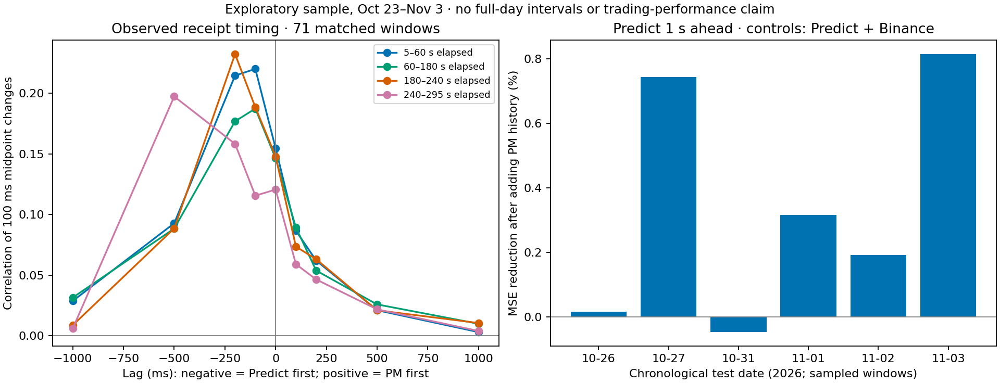

# Polymarket / Predict price timing — 2026-11-10

**The captured Predict quotes generally move first. Polymarket history adds only a small amount to short-horizon Predict forecasting once Predict and Binance history are included.** This is an exploratory price diagnostic, not evidence of executable profit or improved settlement forecasting.

Results as of **2026-11-10 07:38:30 UTC**, independently verified at 07:39:41 UTC. Population: **71 matched BTC five-minute windows across nine previously consumed dates**, from 72 scheduled windows. The dates are Oct 23–27, Oct 31, and Nov 1–3, 2026; the sample takes the first five-minute window of UTC hours 00, 03, 06, 09, 12, 15, 18, 21. Nov 1 at 06:00 is missing the PM input/prestart metadata and remains an exclusion, without replacement. These are partial-day samples, not nine complete days or untouched validation days. No confidence intervals are claimed.

## Observed direction and timing

The primary comparison uses local receipt timestamps, causal last-received Up-token bid/ask midpoints, a 100 ms grid, and a maximum quote age of one second. The correlations below concern **100 ms price changes**, not price levels. Each window/phase is centered separately before pooling. Positive lag means PM first; negative lag means Predict first. Peaks are descriptive maxima among the 15 declared lags, not precise latency estimates.

| Elapsed time in the five-minute window | Strongest alignment | Correlation at peak | Paired changes at peak | Fresh, valid changes at zero lag / scheduled |
|---|---:|---:|---:|---:|
| 5–60 s | Predict first by 100 ms | 0.220 | 38,479 | 38,549 / 39,050 (98.7%) |
| 60–180 s | Predict first by 100 ms | 0.187 | 81,057 | 81,125 / 85,200 (95.2%) |
| 180–240 s | Predict first by 200 ms | 0.232 | 28,209 | 28,334 / 42,600 (66.5%) |
| 240–295 s | Predict first by 500 ms | 0.197 | 5,873 | 6,018 / 39,050 (15.4%) |

All rows cover the same 71 available windows, as of the time above. Counts are correlated grid observations, not independent events or actions. Coverage exclusions at zero lag are recorded separately: invalid midpoint endpoint / stale endpoint = **44 / 457**, **3,429 / 646**, **13,926 / 340**, and **32,977 / 55**, respectively. Invalid means at least one endpoint lacks a strictly two-sided `0 < bid < ask < 100` book on either venue; it does not necessarily mean bad raw data. Near-boundary and one-sided books are excluded by this definition.

Before the final minute, the correlation at a 200 ms Predict lead exceeds the correlation at a 200 ms PM lead on **all nine sampled dates in each of the three phases**. The per-date peak lag varies, with one zero-lag peak in the early phase. Final-minute peaks vary substantially: five negative, three zero, one positive across the nine dates. The pooled 500 ms result there should not be generalized to all near-expiry markets: most scheduled observations are ineligible.

The frozen 500-draw null shifts PM changes by at least ten seconds within each window/phase. Its family statistic is the maximum absolute directional asymmetry across seven positive lag magnitudes and four phases. At 200 ms, the first three phases' adjusted empirical p-values are **0.010, 0.020, 0.006**. The last phase's 500 ms asymmetry has p=0.006. These are timing-alignment diagnostics under that shift null, not day-cluster confidence intervals, venue-causality tests, or strategy validation. Shifting the missingness mask also changes pair availability, particularly near expiry.

Allowing quotes up to five seconds old preserves all four receipt-clock peak lags. Repeating the comparison on venue source timestamps gives a **200 ms Predict-first peak in every phase**, with correlations 0.262, 0.227, 0.261, 0.149. That source-clock view is noncausal: sorting timestamps can expose messages before local receipt, and the venues' clocks have not been independently synchronized.

The median across 71 windows of each window's median receipt-minus-source delay is about **131 ms for Predict and 43 ms for PM**. Thus the captured ordering is not explained simply by Predict's feed reaching this collector faster. These are not pure network-latency measurements: source stamping, batching, buffering and clock offsets remain mixed together. PM also has 517 source-timestamp regressions in the selected BBO rows, versus zero for Predict; receipt order is preserved in the primary analysis.

## Does Polymarket improve Predict forecasting?

The fixed baseline uses recent Predict changes, Binance returns, current Predict price/spread, time remaining, and fixed sensitivity/phase terms. The extended model adds only PM changes over 0.2, 1 and 5 seconds. Training expands through earlier dates; the first three dates initialize training and the next six are scored. Both models use exactly the same eligible observations, with training-only normalization and no parameter tuning.

All rows below cover **47 available test windows on six sampled dates**, as of 07:38:30 UTC. Each horizon has 13,630 scheduled observations. MSE is in squared cents; lower is better. These are chronological test observations within a previously consumed research period, not independent forward validation.

| Future Predict change | Eligible / excluded observations | Zero-change MSE | Predict + Binance MSE | Add PM MSE | MSE reduction from PM | Dates improved |
|---|---:|---:|---:|---:|---:|---:|
| 0.5 s | 10,107 / 3,523 | 3.388716 | 2.873900 | 2.861092 | 0.446% | 5 / 6 |
| **1 s — primary** | **10,108 / 3,522** | **8.248046** | **7.740776** | **7.710208** | **0.395%** | **5 / 6** |
| 5 s | 10,090 / 3,540 | 47.524703 | 47.560684 | 47.520081 | 0.085% | 4 / 6 |

Exclusions mean a missing, invalid or stale feature/target endpoint; the unavailable Nov 1 window is separate from these within-window counts. Per-date primary improvements are +0.016%, +0.744%, −0.048%, +0.316%, +0.192%, +0.815% (Oct 26, 27, 31; Nov 1, 2, 3). The five-second models barely match a zero-change forecast. A smaller prediction error is not a measured improvement in spread capture, inventory risk or P&L.

## Interpretation for the market-making research

The evidence does not support replacing Predict/Binance with PM as a faster short-term pricing anchor. PM may offer complementary information, but its incremental effect in this fixed model is small. This study does not test whether a contract-adjusted PM price-level disagreement helps predict settlement; the model adds price changes, not a fitted cross-contract value basis.

Equal UTC windows do not imply equal payoffs. Selected historical PM metadata names a BTC/USD TWAP reference, while Predict has its own round reference and start/end rules. The exact PM settlement statistic is not asserted here. See the locally pinned `pm_metadata.json` and [Predict's official round-market documentation](https://docs.predict.fun/developers/chainlink-price-markets). Price gaps can reflect different reference prices, strike levels and settlement sensitivity, particularly near expiry; they are not automatically arbitrage or fair-value errors.

Any later strategy test should specify a small incremental PM feature against the existing Predict/Binance baseline, account for the actual feed and order-response delay, and evaluate trading value and inventory together. This report changes no strategy. Queue/fill calibration remains open. Protected dates Nov 4–6 and Nov 9–13 remain unread.

## Reproduction and verification

- Branch: `research/predict-polymarket-leadlag-20261110`, based on `91116bc8`.
- Frozen data/statistics/tests: `e4034cad`; declaration commit `966c0faf`. Initial preparation `d45809d8` refused a scalar Up-index before creating outputs; the correction accepts only scalar integer 1 or a one-element integer array containing 1. No numerical design changed.
- Supplemental independent verifier: `2b65b516`. Presentation source: `6c5fa706`; this only aggregates existing outputs and renders the figure.
- [Declaration](../reviews/polymarket_leadlag_20261110/declaration.json), [full receipt](../reviews/polymarket_leadlag_20261110/receipt.json), [verification](../reviews/polymarket_leadlag_20261110/verification.json), [derived summary](../reviews/polymarket_leadlag_20261110/summary.json).
- Data root: `/home/yuqing/ctaNew/data/predict_fun/research/polymarket_leadlag_20261110`. Contains pinned metadata, input hashes, grids, predictions, report and logs. Large data are not committed.
- Report SHA-256: `c537daecf7f181ee565acf1c390d9600f2a16ca391fe658d2bdd9fdd2c03b8b3`.
- Seven positive/falsifier tests passed. The independent verifier reconstructed **240 correlation/count pairs**, checked **30,305 saved prediction rows** across three horizons against grid targets, and reconciled MSE and date ordering. Its planted-lag control and two corrupt-value refusals passed. Those rows are not 30,305 independent observations.
- Full data build: 82.94 s, 227 MiB peak RSS; statistics: 27.96 s, 165 MiB; verifier: 6.57 s, 148 MiB. Each ran serially through `run_light.sh`. Presentation finished at 07:45:02 UTC, 171 MiB peak. Research slot released; recheck before another job.

Pipeline modules are `pf_pm_leadlag_data declare`, `pf_pm_leadlag_data build`, `pf_pm_leadlag_stats`, `pf_pm_leadlag_verify`, and `pf_pm_leadlag_present`, under `predictfun.research`. They refuse source/input changes or existing output artifacts where applicable. Preserve this run; use an explicitly superseding destination/declaration for any rerun rather than overwriting frozen evidence. Price changes are classified by their end time; both lagged change times stay in the same phase/window. No settlement outcomes, simulated fills or live orders were used.
