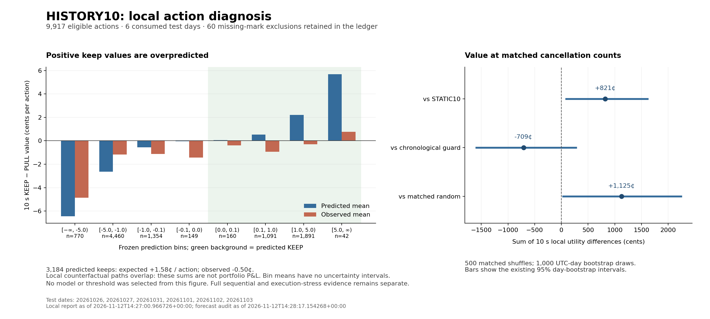

# Model upgrade — complete local results, sequential evaluation pending

Completion update, 2026-11-13T02:37:37.072135+00:00: [all eighteen sequential
runs and final audits are now complete](20261113_model_upgrade_complete_review.md).
The primary/stress, age500 and combined improvement tests fail. The local
results and dated progress snapshots below remain historical evidence.

The temporal features improve local action ranking over the same value model without history, but this experiment has not established a better guard. The candidate fails to beat the chronological guard in the matched-count point estimate, and its predicted positive keep region still has negative aggregate observed value. The frozen full sequential evaluation is running; no candidate is promoted.

Population: 9,917 eligible sampled neutral actions on six consumed test dates (20261026/27/31, 20261101/02/03), plus 60 paired missing-mark exclusions retained in the ledger. These come from complete 288-window input builds on every date. Local report as of2026-11-12T14:27:00.966726+00:00; independent saved-forecast audit as of2026-11-12T14:28:17.154268+00:00; component audit as of2026-11-12T14:29:18.143009+00:00. Training and calibration use strictly earlier dates. These dates are consumed exploratory history, not untouched validation.

| Frozen score | Pull actions | Keep actions | Own-target RMSE, cents | Earlier-core mean RMSE, cents |
|---|---:|---:|---:|---:|
| STATIC2 | 7,491 | 2,426 | 13.497 | 13.415 |
| STATIC10 | 6,842 | 3,075 | 15.787 | 15.699 |
| HISTORY10, primary | 6,733 | 3,184 | 15.762 | 15.699 |
| JOINT10, diagnostic | 9,917 | 0 | 15.684 | 15.699 |

The own-target errors are from `forecast_calibration_v2.json`. STATIC2 predicts2s; the other models predict10s. The original report's STATIC2 error against10s is a cross-horizon diagnostic, superseded as a forecast-calibration claim. All saved model forecasts were reconstructed, including calibration populations and the earlier-only guard, without refitting.

At HISTORY10's matched cancellation counts, its incremental10s local utility is +820.96c versus STATIC10 (UTC-day bootstrap interval +73.31 to +1631.54c), -708.58c versus the chronological guard (-1612.64 to +289.19c), and +1125.30c versus the matched-random expectation (+14.72 to +2257.33c). Matching uses day/side/hour/order-age/inventory-sign cells. There are500 null draws and1000 UTC-day bootstrap draws. These sums cover overlapping local counterfactual paths; they are not portfolio profit. The guard comparison's interval crosses zero, so this is failure to establish superiority, not proof that the guard is always better.

HISTORY10 predicts +5017.47c in aggregate advantage on its3184keeps, while the observed10s keep-minus-pull advantage is -1593.92c. The corresponding counterfactual pull breakdown on those same retained actions is1975.87c less branch loss,389.70c forfeited branch gain, and7.75c less inventory penalty, net+1593.92c. Thus the observed keep-region problem is chiefly marked branch value, not the inventory penalty. Branch gain/loss are signs of aggregate branch marks; they are not identified favorable/adverse individual fills. The score bins and per-day component rows remain visible in the receipts; no threshold was changed after seeing them.

JOINT10 slightly improves mean forecast error but chooses pull everywhere. Its matched-action comparisons are necessarily zero and have no shuffleable decisions. This is not evidence of useful selective quoting. The separately completed upstream continuation study also pulls all9917eligible test actions with every joint variant (report as of2026-11-12T14:25:17.782695+00:00); its independent audit binds the exact result. It supplies context, not a substitute benchmark for this experiment.

What this changes: temporal inputs show some incremental ranking value, but accurate estimates of positive retention value remain unproven. A reduction in cancellation count alone would not resolve that problem. The predeclared HISTORY10 candidate remains fixed for the full five-policy replay under primary, conservative and young-fill-suppressed execution. Portfolio marked value, inventory-square exposure, quote-presence unions, repeated decisions and fill-age dependence will determine whether the local result transfers. No local ranking or error metric can promote it.

Current receipts:

- `reviews/model_upgrade_20261112_v2/result.json`: complete local comparison, folds, populations, fixed nulls and predicates.
- `reviews/model_upgrade_20261112_v2/forecast_calibration_v2.json`: independently reconstructed forecasts and own-horizon calibration.
- `reviews/model_upgrade_eval_20261112_v2/local_value_detail.json`: exact per-day branch-value decomposition.
- `reviews/model_upgrade_20261112_v2/final_input_verified.json`: direct hashes of all seven final-day upstream artifacts.
- `forecast_early_*` and `local_detail_early_*`: bounded read-only scheduling receipts; no change to models, policies or selection.

The live fill/cancel/queue model remains uncalibrated. The age500 sequential sensitivity is a deliberately conservative scenario, not an empirical venue rule. Final settlement/carry reports will use the separately declared tie-payout correction in `result_settlement_v3.json`; marks, targets and policy decisions remain unchanged. No live trading change or forward-validation claim.

## First full-day quote-presence checkpoint

The complete Oct26 primary replay covers 288 windows per policy (run as of 2026-11-12T15:08:26.592219+00:00; presence audit as of 2026-11-12T15:27:05.785448+00:00). It is one of six primary dates, with no interval or six-day performance claim. The partition reconciles exactly to the original accepted-order side-time unions, including overlapping generations. All windows remain included.

| Policy | Any quote, first 60 s | Both sides, first 60 s | Any quote, whole 240.1 s |
|---|---:|---:|---:|
| default | 88.69% | 45.40% | 24.68% |
| legacy_guard | 9.72% | 0.01% | 2.87% |
| causal_guard | 12.83% | 0.04% | 3.96% |
| static10 | 22.78% | 3.53% | 7.66% |
| history10 | 25.88% | 2.67% | 8.86% |

The fixed reduce-only cutoff explains part of the low whole-window uptime, but the temporal model still has sparse quote presence during the first minute. Its higher any-side presence than the chronological guard does not establish better profitability or useful queue retention. Both-side presence is especially limited. The original whole-window side-time fraction averages the two sides; it is a different measure from time with at least one order. No policy, threshold or evaluation gate changed in response to this checkpoint.

Source: `reviews/model_upgrade_eval_20261112_v2/presence_X_20261026.json`; supplemental design and positive/refusal controls: `reviews/model_upgrade_20261112_v2/presence_detail_*`. These are simulated accepted-order intervals, not live uptime or guaranteed fillable liquidity. Remaining primary/stress/age results and their complete descriptive partitions are pending.

## Second full-day quote-presence checkpoint

The Oct27 primary replay passed all five policies and 288 windows each at 2026-11-12T15:48:59.742685+00:00; all 453 saved inference samples pass reconstruction. The direct completion-check instrument verified 31 exact artifacts and row populations at 2026-11-12T15:50:23.911148+00:00. Phase-presence audit as of 2026-11-12T15:50:34.147706+00:00. Two of six primary days are now complete; no interval or complete-strategy conclusion is available.

| Policy | Any quote, first 60 s | Both sides, first 60 s |
|---|---:|---:|
| default | 89.09% | 45.74% |
| legacy_guard | 9.30% | 0.00% |
| causal_guard | 10.87% | 0.02% |
| static10 | 24.67% | 4.02% |
| history10 | 27.42% | 3.06% |

This second consumed day shows the same operational pattern: greater any-side presence than the chronological guard, but sparse two-side quoting and much less presence than default. It does not establish that the added presence is profitable. Both daily audits retain every window and reconcile exactly to the original union exposure. Full primary/stress/age portfolio comparisons remain pending; no model or threshold changed.

Sources: `reviews/model_upgrade_20261112_v2/checkpoint_X_20261027.json` and `reviews/model_upgrade_eval_20261112_v2/presence_X_20261027.json`.

## Third full-day checkpoint and age-control correction

Oct31 primary replay passed at 2026-11-12T16:32:06.746257+00:00: five policies × 288 windows, exact default-reference parity, and 631 independently reconstructed saved inference samples. Direct artifact/count verification is in `checkpoint_X_20261031.json`; phase audit as of 2026-11-12T16:35:32.574490+00:00. Three primary dates are complete, with no interval or complete-strategy conclusion.

| Policy | Any quote, first 60 s | Both sides, first 60 s |
|---|---:|---:|
| default | 89.94% | 47.10% |
| legacy_guard | 27.24% | 0.17% |
| causal_guard | 20.70% | 0.10% |
| static10 | 28.24% | 5.54% |
| history10 | 28.33% | 3.03% |

Both predeclared eight-window age smoke gates are now verified. Zero-floor replay exactly reproduces the reference. The age500 replay passed engine accounting, then exposed a validator bug: empty guard fill tables have object-typed age columns, causing `np.isfinite` to raise. Version3 accepts a genuinely empty table with an existing age column, while refusing nonnumeric or invalid nonempty ages. The completed simulation was preserved and checked again without an engine rerun. `age_smoke_early_v3.json` supersedes the preserved failure receipt. These are integration/control results, not full age-stress performance or an empirical venue age rule.

## Fourth full-day quote-presence checkpoint

Nov1 primary replay passed at 2026-11-12T17:15:55.442727+00:00, with five policies × 288 windows and 573 independently reconstructed inference samples. Direct artifact/count verification is in `checkpoint_X_20261101.json`; presence audit as of 2026-11-12T17:18:21.247548+00:00. Four of six primary dates are complete. No interval or complete-strategy conclusion is reported at this checkpoint.

| Policy | Any quote, first 60 s | Both sides, first 60 s |
|---|---:|---:|
| default | 88.56% | 45.12% |
| legacy_guard | 23.87% | 0.10% |
| causal_guard | 18.52% | 0.06% |
| static10 | 27.45% | 5.44% |
| history10 | 26.96% | 3.26% |

The temporal model again has sparse quote presence. Its any-side presence is below STATIC10 on this day, so increased presence versus the static model is not uniform across these partial results. This is a descriptive operational observation, not a trading-value comparison or selection criterion. Full primary/stress/age evidence remains pending.

## Final two primary quote-presence checkpoints

All six primary replay days now have direct artifact/count and quote-presence checks. For Nov2 and Nov3, the evidence checker verified 31 named artifacts per day, including actual parquet populations. Each presence audit retains all 288 windows per policy and reconciles its phase unions to the original exposure. These are per-day descriptive measurements, with no interval or policy selection.

20261102: replay as of 2026-11-12T17:55:48.210823+00:00; presence audit as of 2026-11-12T19:05:45.417653+00:00.

| Policy | Any quote, first 60 s | Both sides, first 60 s |
|---|---:|---:|
| default | 88.63% | 44.71% |
| legacy_guard | 9.10% | 0.01% |
| causal_guard | 10.48% | 0.01% |
| static10 | 21.75% | 3.55% |
| history10 | 23.53% | 2.54% |

20261103: replay as of 2026-11-12T18:35:53.689595+00:00; presence audit as of 2026-11-12T19:06:10.124475+00:00.

| Policy | Any quote, first 60 s | Both sides, first 60 s |
|---|---:|---:|
| default | 89.13% | 45.70% |
| legacy_guard | 9.75% | <0.01% |
| causal_guard | 9.37% | <0.01% |
| static10 | 21.24% | 3.44% |
| history10 | 22.79% | 2.41% |

HISTORY10 has higher any-side presence than STATIC10 on these two days, with lower simultaneous two-side presence. Quoting remains sparse during the first minute. This is an operational observation from simulated accepted-order intervals; it does not establish profitable queue retention or live quote availability. The full primary/stress/age strategy comparison remains pending. No model, threshold, policy or selection criterion changed.

Sources: `reviews/model_upgrade_20261112_v2/checkpoint_X_20261102.json`, `checkpoint_X_20261103.json`, and `reviews/model_upgrade_eval_20261112_v2/presence_X_20261102.json`, `presence_X_20261103.json`.

## First conservative execution checkpoint

Oct26 stress replay passed at 2026-11-12T19:16:10.866135+00:00, with five policies × 288 windows and 353 sampled inference reconstructions. Direct artifact/count verification passed at 2026-11-12T19:17:29.265431+00:00; the phase-presence audit passed at 2026-11-12T19:17:39.160165+00:00. This is one of six stress dates, with no interval or complete strategy comparison.

| Policy | Any quote, first 60 s | Both sides, first 60 s |
|---|---:|---:|
| default | 88.22% | 40.51% |
| legacy_guard | 10.93% | 0.01% |
| causal_guard | 14.32% | 0.06% |
| static10 | 28.52% | 4.41% |
| history10 | 31.26% | 4.08% |

Interpret presence alongside value and inventory risk: the conservative scenario changes execution clocks and queue assumptions, and slower cancellations can keep unwanted orders active longer. The additional presence alone does not establish useful queue retention. Model, threshold and policy remain frozen. All windows are retained and phase unions reconcile.

Sources: `reviews/model_upgrade_20261112_v2/checkpoint_stress_20261026.json` and `reviews/model_upgrade_eval_20261112_v2/presence_stress_20261026.json`.

## Second conservative execution checkpoint

Oct27 stress replay passed at 2026-11-12T19:55:35.606817+00:00, with five policies × 288 windows and 387 sampled inference reconstructions. Direct artifact/count verification passed at 2026-11-12T19:56:19.508433+00:00; the phase-presence audit passed at 2026-11-12T19:56:29.381173+00:00. Two of six stress dates are complete. These are per-day descriptive measurements, with no interval or complete strategy comparison.

| Policy | Any quote, first 60 s | Both sides, first 60 s |
|---|---:|---:|
| default | 88.59% | 42.91% |
| legacy_guard | 10.53% | 0.01% |
| causal_guard | 12.32% | 0.03% |
| static10 | 29.82% | 5.44% |
| history10 | 32.21% | 4.66% |

Simultaneous two-side quoting remains limited. Presence under the changed execution assumptions must be interpreted alongside portfolio value and inventory risk. All windows are retained and phase unions reconcile; no policy or threshold is selected from this checkpoint. Full stress, age and aggregate comparisons remain pending.

Sources: `reviews/model_upgrade_20261112_v2/checkpoint_stress_20261027.json` and `reviews/model_upgrade_eval_20261112_v2/presence_stress_20261027.json`.

## Third conservative execution checkpoint

Oct31 stress replay passed at 2026-11-12T20:37:24.094107+00:00, with five policies × 288 windows and 558 sampled inference reconstructions. Direct artifact/count verification passed at 2026-11-12T20:38:45.882121+00:00; the phase-presence audit passed at 2026-11-12T20:38:55.952326+00:00. Three of six stress dates are complete. These are per-day descriptive measurements, with no interval or complete strategy comparison.

| Policy | Any quote, first 60 s | Both sides, first 60 s |
|---|---:|---:|
| default | 89.52% | 47.07% |
| legacy_guard | 27.63% | 0.22% |
| causal_guard | 22.01% | 0.14% |
| static10 | 33.14% | 7.47% |
| history10 | 33.89% | 4.91% |

The candidate continues to have limited simultaneous two-side quoting. Presence under the changed execution assumptions must be interpreted alongside portfolio value and inventory risk. All windows are retained and phase unions reconcile; no policy or threshold is selected from this checkpoint. Complete stress, age and aggregate comparisons remain pending.

Sources: `reviews/model_upgrade_20261112_v2/checkpoint_stress_20261031.json` and `reviews/model_upgrade_eval_20261112_v2/presence_stress_20261031.json`.

## Fourth conservative execution checkpoint

Nov1 stress replay passed at 2026-11-12T21:18:23.549209+00:00, with five policies × 288 windows and 527 sampled inference reconstructions. Direct artifact/count verification passed at 2026-11-12T21:19:31.648580+00:00; the phase-presence audit passed at 2026-11-12T21:19:41.619048+00:00. Four of six stress dates are complete. These are per-day descriptive measurements, with no interval or complete strategy comparison.

| Policy | Any quote, first 60 s | Both sides, first 60 s |
|---|---:|---:|
| default | 88.48% | 45.70% |
| legacy_guard | 24.73% | 0.10% |
| causal_guard | 20.10% | 0.08% |
| static10 | 32.95% | 6.91% |
| history10 | 33.19% | 4.96% |

Simultaneous two-side quoting remains limited. Presence under the changed execution assumptions must be interpreted alongside portfolio value and inventory risk. All windows are retained and phase unions reconcile; no policy or threshold is selected from this checkpoint. Complete stress, age and aggregate comparisons remain pending.

Sources: `reviews/model_upgrade_20261112_v2/checkpoint_stress_20261101.json` and `reviews/model_upgrade_eval_20261112_v2/presence_stress_20261101.json`.

## Fifth conservative execution checkpoint

Nov2 stress replay passed at 2026-11-12T21:57:00.316909+00:00, with five policies × 288 windows and 332 sampled inference reconstructions. Direct artifact/count verification passed at 2026-11-12T21:58:44.197960+00:00; the phase-presence audit passed at 2026-11-12T21:58:54.067158+00:00. Five of six stress dates are complete. The declared comparison still requires all six. These are per-day descriptive measurements, with no interval or complete strategy comparison.

| Policy | Any quote, first 60 s | Both sides, first 60 s |
|---|---:|---:|
| default | 88.21% | 40.98% |
| legacy_guard | 10.33% | 0.02% |
| causal_guard | 11.74% | 0.02% |
| static10 | 29.37% | 4.69% |
| history10 | 30.82% | 3.94% |

Simultaneous two-side quoting remains limited. Presence under the changed execution assumptions must be interpreted alongside portfolio value and inventory risk. All windows are retained and phase unions reconcile; no policy or threshold is selected from this checkpoint. Complete stress, age and aggregate comparisons remain pending.

Sources: `reviews/model_upgrade_20261112_v2/checkpoint_stress_20261102.json` and `reviews/model_upgrade_eval_20261112_v2/presence_stress_20261102.json`.

## 2026-11-12T22:40:15.531042+00:00 — sixth conservative execution checkpoint

Nov3 stress replay passed at 2026-11-12T22:35:55.238500+00:00, with five policies × 288 windows and 316 sampled inference reconstructions. The direct artifact/count check and unchanged phase-presence audit pass. All six primary and six stress dates are now complete; the separate primary/stress decision review reports their full matched comparisons. This per-day presence table remains descriptive.

| Policy | Any quote, first 60 s | Both sides, first 60 s |
|---|---:|---:|
| default | 88.57% | 41.89% |
| legacy_guard | 10.93% | 0.00% |
| causal_guard | 10.60% | 0.01% |
| static10 | 29.00% | 5.17% |
| history10 | 30.44% | 3.57% |

All windows are retained and phase unions reconcile. Sources: `reviews/model_upgrade_20261112_v2/checkpoint_stress_20261103.json` and `reviews/model_upgrade_eval_20261112_v2/presence_stress_20261103.json`. Read [the complete primary/stress decision review](20261112_model_upgrade_primary_review.md). Full age sensitivity and aggregate presence remain pending.

## First complete fill-age sensitivity checkpoint

Oct26 age500 replay passed at 2026-11-12T23:18:50.735874+00:00, with five policies × 288 windows and 370 sampled inference reconstructions. The age audit passed at 2026-11-12T23:18:50.956699+00:00: all credited fills have actual order age at least 500 ms. It recorded 39,510 suppressed opportunity events; these are simulator events, not a count of distinct real fills or a measured venue fill probability. Direct artifact/count verification checks 34 named artifacts. Phase-presence accounting passed at 2026-11-12T23:19:56.397901+00:00. One of six age dates is complete; no age-strategy interval or full comparison is available.

| Policy | Any quote, first 60 s | Both sides, first 60 s |
|---|---:|---:|
| default | 89.35% | 53.21% |
| legacy_guard | 10.10% | 0.01% |
| causal_guard | 13.49% | 0.04% |
| static10 | 24.31% | 4.49% |
| history10 | 27.68% | 3.34% |

All windows are retained and phase unions reconcile. Fill suppression changes later inventory, reservations and decisions, so this is a full alternate path, not a post-hoc fill-age filter. The 500 ms floor is a sensitivity assumption, not a calibrated venue rule. Sources: `reviews/model_upgrade_20261112_v2/checkpoint_age500_20261026.json`, `reviews/model_upgrade_age_20261112_v2/full_age500_20261026_age_check.json` and `reviews/model_upgrade_age_20261112_v2/presence_age500_20261026.json`.

## Second complete fill-age sensitivity checkpoint

Oct27 age500 passed as of 2026-11-12T23:59:22.006865+00:00: five policies × 288 windows,
439 saved inference reconstructions, and 34 directly bound artifacts. The corrected
age audit passes at 2026-11-12T23:59:22.072239+00:00, with no credited fill below 500 ms and
36,706 suppressed opportunity events. Phase-presence accounting passes as of
2026-11-13T00:00:08.340510+00:00. Two of six age dates are complete; no partial-day-set interval
or policy selection is made.

| Policy | Any quote, first 60 s | Both sides, first 60 s |
|---|---:|---:|
| default | 89.55% | 52.27% |
| legacy_guard | 9.73% | 0.00% |
| causal_guard | 11.47% | 0.02% |
| static10 | 24.91% | 4.49% |
| history10 | 28.49% | 3.74% |

All windows, including zero-presence windows, are retained. This alternate full path suppresses young fill credit; it is not a calibrated venue rule or a post-hoc fill filter. Sources: `reviews/model_upgrade_20261112_v2/checkpoint_age500_20261027.json` and `reviews/model_upgrade_age_20261112_v2/presence_age500_20261027.json`. The complete primary/stress failure is unchanged.

## Third complete fill-age sensitivity checkpoint

Oct31 age500 passed as of 2026-11-13T00:40:10.843422+00:00: five policies × 288 windows and
471 saved inference reconstructions. The corrected age audit passes at
2026-11-13T00:40:10.912519+00:00; no credited fill is younger than 500 ms. There are 20,654
suppressed opportunity events, not a count of distinct real fills. The
34-artifact checkpoint verifies named identities/counts; phase-presence
accounting passes at 2026-11-13T00:42:53.486941+00:00. Three of six age dates are complete;
no partial-set interval or model selection is added.

| Policy | Any quote, first 60s | Both sides, first 60s |
|---|---:|---:|
| default | 90.19% | 52.69% |
| legacy_guard | 27.92% | 0.19% |
| causal_guard | 21.51% | 0.11% |
| static10 | 27.23% | 6.08% |
| history10 | 29.10% | 3.44% |

All windows, including zero-presence windows, remain included. This is a complete alternate execution path, not a calibrated venue rule. Sources: `reviews/model_upgrade_20261112_v2/checkpoint_age500_20261031.json` and `reviews/model_upgrade_age_20261112_v2/presence_age500_20261031.json`. The complete primary/stress failure is unchanged.

## Fourth complete fill-age sensitivity checkpoint

Nov1 age500 passed as of 2026-11-13T01:19:32.963948+00:00: five policies × 288 windows and
454 saved inference reconstructions. The corrected age audit passes at
2026-11-13T01:19:33.032258+00:00; no credited fill is younger than 500 ms. There are
21,924 suppressed opportunity events, not distinct real fills. The
34-artifact checkpoint and phase-presence accounting pass (presence as of
2026-11-13T01:20:56.627911+00:00). Four of six age dates are complete; no partial-set
interval or model selection is added.

| Policy | Any quote, first 60s | Both sides, first 60s |
|---|---:|---:|
| default | 88.68% | 49.51% |
| legacy_guard | 25.23% | 0.11% |
| causal_guard | 19.64% | 0.08% |
| static10 | 25.85% | 5.36% |
| history10 | 26.76% | 3.40% |

All windows, including zero-presence windows, remain included. This alternate
execution path is a sensitivity, not a calibrated venue rule. Sources:
`reviews/model_upgrade_20261112_v2/checkpoint_age500_20261101.json` and
`reviews/model_upgrade_age_20261112_v2/presence_age500_20261101.json`. The complete
primary/stress failure is unchanged.

## Fifth complete fill-age sensitivity checkpoint

Nov2 age500 passed as of 2026-11-13T01:58:16.457165+00:00: five policies × 288 windows and
300 saved inference reconstructions. The corrected age audit passes at
2026-11-13T01:58:16.523156+00:00; no credited fill is younger than 500 ms. There are
27,122 suppressed opportunity events, not distinct real fills. The
34-artifact checkpoint and phase-presence accounting pass (presence as of
2026-11-13T02:00:12.417506+00:00). Five of six age dates are complete; the declared
full report still requires all six. No partial-set interval or selection is added.

| Policy | Any quote, first 60s | Both sides, first 60s |
|---|---:|---:|
| default | 88.96% | 49.31% |
| legacy_guard | 9.51% | 0.01% |
| causal_guard | 10.94% | 0.01% |
| static10 | 22.39% | 3.87% |
| history10 | 24.20% | 2.91% |

All windows, including zero-presence windows, remain included. This alternate
execution path is a sensitivity, not a calibrated venue rule. Sources:
`reviews/model_upgrade_20261112_v2/checkpoint_age500_20261102.json` and
`reviews/model_upgrade_age_20261112_v2/presence_age500_20261102.json`. The complete
primary/stress failure is unchanged.
