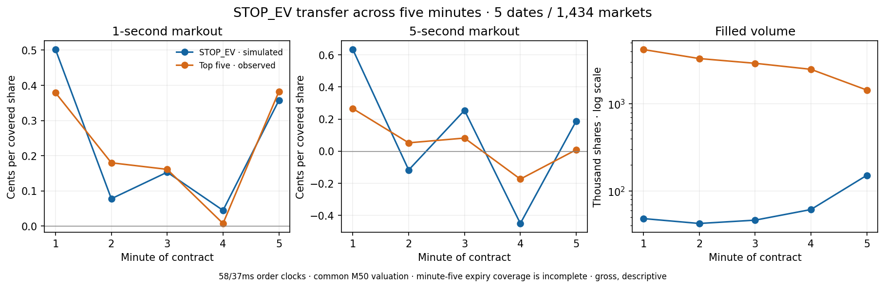

# STOP_EV across the five-minute contract

As of 2026-11-16T07:34:03.967237+00:00. Five consumed dates: 2026-10-27, 2026-10-31, 2026-11-01 through 2026-11-03; 1,434 common market windows, six Oct31 boundary exclusions. Frozen corrected-v3 STOP_EV, placement 58 ms / cancellation 37 ms, notice 100 ms, review 50 ms, M50 / queue M, six 30-share rungs per side, no cap/cooldown. Quoting ends at 299.8 s and the cancellation tail ends at 300 s. Orders and inventory carry across minute boundaries. No model retraining or inventory-control change.

Top five are ranked per date by maker volume during 0–240 s on these same markets, not by profitability. Their public executed quantities and our simulated fills are valued on the same M50/imputation convention. This aligns accounting and market coverage; it does not make the two fill populations interchangeable or validate simulated execution.

All tables retain fills. Markout denominators include only fills with that horizon available before expiry; censored and missing quantities are explicit. All dollar columns are five-date totals. Positive markout is not an executable liquidation profit. The first-minute-trained model is being applied to an untrained later phase.

## Interpretation

**The first-minute advantage does not carry consistently through the contract.**
The common-date, common-clock first-minute comparison is +0.502 c/share versus
+0.379 for the five largest makers by daily volume. In minutes 2 and 4,
STOP_EV retains only +0.078 and +0.045 c/share at one second, and its five-second
markout becomes -0.118 and -0.451. Minute 3 recovers partly; minute 5 is positive
but has materially incomplete long-horizon coverage.

The weakness in minutes 2 and 4 already appears before inventory carry:
initial edge of +1.028 / +1.304 c/share suffers -0.950 / -1.259 c/share of
one-second adverse movement. At the contemporaneous best quote, STOP_EV's
one-second markout is -0.085, -0.122, and -0.166 in minutes 2–4; the top-five
benchmark is +0.146, +0.113, and +0.053. Pooled one-second STOP_EV values are
positive in all five minutes, but minutes 2 and 4 are positive on only two of
five dates. No significance claim is made.

**The maker ranking is sensitive to the timestamp-source population.**
On WS-timed fills alone, first-minute STOP_EV is +0.438 c/share versus +0.557
for TOP5, reversing the all-source ranking. These remain different fill
populations; neither comparison establishes live superiority. Across the full
contract, STOP_EV fills 348,913 simulated shares versus 14,347,607 observed
TOP5 shares (41.12 times as many for TOP5). First-minute quantities are
48,173 versus 4,195,371. TOP5 membership is ranked retrospectively by volume,
not profit, and includes five identities per date rather than necessarily the
same five identities throughout.

The later-phase transfer is incomplete. The frozen model was trained on first-minute
states. Known-book feature-row eligibility falls from 99.97% of review steps in
minute 1 to 88.17% in minute 4 and 58.89% in minute 5; these rows require a known,
valid two-sided book. All scheduled steps have their base feature row. Among
eligible rows, missing feature cells remain below 0.016% in minutes 2–5, so
blank feature columns are not the explanation for the observed decline.
This does not establish that training coverage alone causes the losses: phase,
price level, volatility, fill mix, and selection all change together.

Older filled orders have better observed markouts: the >=500 ms age subset
has +0.294 / +0.581 / +0.294 c/share in minutes 2–4. This is conditional on
surviving and filling; it is not evidence that mechanically keeping every
order or imposing a waiting timer would improve the policy.

**Prediction quality and inventory remain separate.** Full-contract terminal
marked P&L is -$964.95 and passive settlement P&L is -$4,143.34. Mean absolute
ending inventory rises from 22.41 shares after minute 1 to 107.81 after minute 5.
These values include no inventory policy, fees or rewards. The observed-maker
fill-basket settlement sums are not their actual account P&L.

Next research implication: diagnose the adverse fills at the best quote in
minutes 2–4, with phase-appropriate training coverage and consistent timestamp
sources. Evaluate a new candidate by replay before adopting any phase restriction;
this consumed-data comparison does not validate a rule selected from these results.

## Fill quality and volume by minute

| Minute | Population | Filled shares | Initial edge c/sh | +100ms c/sh | +1s c/sh | +5s c/sh | +1s value $ | 1s / 5s coverage % |
|---|---|---:|---:|---:|---:|---:|---:|---:|
| 1 | STOP_EV | 48,173 | 1.124 | 0.591 | 0.502 | 0.633 | +241.63 | 100.00 / 100.00 |
| 1 | TOP5 | 4,195,371 | 1.446 | 0.633 | 0.379 | 0.265 | +15,893.86 | 100.00 / 100.00 |
| 1 | OTHER_MAKERS | 7,455,855 | 1.030 | 0.300 | -0.168 | -0.277 | -12,526.57 | 100.00 / 100.00 |
| 2 | STOP_EV | 42,331 | 1.028 | 0.491 | 0.078 | -0.118 | +32.89 | 100.00 / 100.00 |
| 2 | TOP5 | 3,307,117 | 1.439 | 0.591 | 0.180 | 0.052 | +5,946.24 | 100.00 / 100.00 |
| 2 | OTHER_MAKERS | 6,051,245 | 0.998 | 0.344 | -0.106 | -0.173 | -6,435.20 | 100.00 / 100.00 |
| 3 | STOP_EV | 46,200 | 1.129 | 0.598 | 0.153 | 0.254 | +70.70 | 100.00 / 100.00 |
| 3 | TOP5 | 2,917,558 | 1.419 | 0.578 | 0.161 | 0.081 | +4,702.82 | 100.00 / 100.00 |
| 3 | OTHER_MAKERS | 6,604,510 | 0.941 | 0.303 | -0.133 | -0.194 | -8,775.49 | 100.00 / 100.00 |
| 4 | STOP_EV | 61,183 | 1.304 | 0.419 | 0.045 | -0.451 | +27.33 | 100.00 / 100.00 |
| 4 | TOP5 | 2,488,202 | 1.559 | 0.594 | 0.007 | -0.174 | +184.93 | 100.00 / 100.00 |
| 4 | OTHER_MAKERS | 6,682,700 | 0.814 | 0.264 | -0.138 | -0.192 | -9,250.03 | 100.00 / 100.00 |
| 5 | STOP_EV | 151,026 | 1.761 | 0.660 | 0.357 | 0.188 | +528.63 | 98.05 / 86.28 |
| 5 | TOP5 | 1,439,358 | 2.178 | 0.947 | 0.382 | 0.008 | +5,488.07 | 99.84 / 98.65 |
| 5 | OTHER_MAKERS | 6,728,807 | 1.543 | 0.852 | 0.388 | 0.293 | +25,497.44 | 97.56 / 89.51 |

## STOP_EV inventory and continuous marked value

| Minute | Incremental marked P&L $ | Cumulative marked P&L $ | Mean abs inventory | Mean abs ending inventory | Max abs inventory | Any / both quote % | Submissions / guard pulls |
|---|---:|---:|---:|---:|---:|---:|---:|
| 1 | +149.23 | +149.23 | 13.27 | 22.41 | 919.79 | 23.01 / 3.37 | 189,968 / 174,669 |
| 2 | -191.88 | -42.65 | 29.45 | 34.37 | 1274.30 | 29.85 / 5.29 | 208,835 / 194,624 |
| 3 | -466.32 | -508.97 | 40.70 | 45.60 | 1621.36 | 33.22 / 5.72 | 218,910 / 203,720 |
| 4 | -1,665.69 | -2,174.66 | 52.96 | 60.74 | 1935.99 | 32.31 / 5.26 | 216,890 / 198,328 |
| 5 | +1,209.71 | -964.95 | 79.44 | 107.81 | 2214.26 | 27.63 / 5.71 | 225,737 / 194,237 |

These inventory measures describe only the simulated strategy. Observed maker fills do not reveal their starting inventory, taker executions, hedges or complete account P&L. Minute marked increments include the movement of inventory carried from earlier minutes; they are not sums of independent minute restarts. Guard pulls exclude routine price and final cancellations.

## Per-date one-second markout c/share

| Date | Population | Minute1 | Minute2 | Minute3 | Minute4 | Minute5 |
|---|---|---:|---:|---:|---:|---:|
| 20261027 | STOP_EV | 0.674 | 0.252 | 0.587 | -0.106 | 1.188 |
| 20261027 | TOP5 | 0.329 | 0.208 | 0.162 | -0.134 | 0.420 |
| 20261031 | STOP_EV | 0.257 | 0.980 | -0.084 | 0.334 | 0.383 |
| 20261031 | TOP5 | 0.394 | 0.008 | -0.061 | -0.191 | -0.126 |
| 20261101 | STOP_EV | 0.524 | -0.059 | 0.009 | -0.048 | 0.170 |
| 20261101 | TOP5 | 0.365 | 0.252 | 0.348 | 0.338 | 0.639 |
| 20261102 | STOP_EV | -0.007 | -0.312 | -0.110 | 0.432 | 0.151 |
| 20261102 | TOP5 | 0.444 | 0.269 | 0.219 | 0.006 | 0.349 |
| 20261103 | STOP_EV | 0.759 | -0.089 | 0.054 | -0.380 | -0.280 |
| 20261103 | TOP5 | 0.369 | 0.119 | 0.135 | 0.105 | 0.244 |

## Coverage, controls and limits

All 1,434 independent 60.2 s control replays match the prior scorecard including fill identities; first-minute market inputs match bit-for-bit. All 1,434 continuous trajectories match the stopped control up to 59.2 s, when its clipped final horizon can first differ. The continuous first minute can therefore differ near its end from the original stopped-first-minute scorecard. Minute bins end at exactly 60 s; the old stopped control included its cancellation tail through 60.2 s. In this sample, the first-minute fill-quality totals happen to match the old scorecard; its minute-end inventory mark uses 60.0 s rather than 60.2 s.

All 3,097,373 exported records reconcile to the minute tables and raw-book markouts. Inventory sums reconcile to engine cash, position and terminal value. Corrupted values and horizon statuses are refused. The full comparison still depends on the inherited queue, trade-time and imputation assumptions. No inference, untouched validation or promotion claim is made.

Near-expiry unavailable markouts are not replaced with settlement or the last midpoint. Midpoints older than 1 s are counted and retained as a separate coverage diagnostic. Source and order-age partitions are in `attribution.csv`; actual-depth partitions are in `depth_attribution.csv`; horizon-specific denominators and missing/censored counts are in the CSV/JSON. Values attributed to a subset of fills are not a replay that removes the other fills.

Artifacts: `reviews/stop_ev_minutes_20261116/results_v3/`; per-fill ledgers, feature coverage and input/status receipts: `data/predict_fun/research/stop_ev_minutes_20261116_v3/`. The original scorecard, model files and historical maker study remain unchanged.

### Population and final audit

Raw selected maker legs: 3,064,772. The declared M50 time convention puts
4,137 before contract start and 15 at or after expiry; 3,060,620 are retained.
No maker legs are lost outside the loader context. The raw maker population
and share sums reconcile. There are also 36,753 simulated fill records, for
3,097,373 exported records in total. Near-expiry coverage differs substantially:
minute-five five-second coverage is 86.28% for STOP_EV and 98.65% for TOP5;
corresponding one-second coverage is 98.05% and 99.84%. Earlier minutes have
100% coverage for both. Unavailable horizons are explicit censored values.

In `minute_totals.csv`, the inherited `e2_shares` field means non-WS shares and
includes imputed shares. Use `attribution.csv` for mutually exclusive WS, E2,
and IMPUTED partitions. All percentages and subset means retain their own
quantity denominators; subsets are not counterfactual removal strategies.

Final audit as of 2026-11-16T07:34:10.553138+00:00:
`results_v3/audit_v1.json` verifies report/CSV identity, original input and
output hashes, raw-maker population, and markout = initial edge + midpoint
drift wherever both marks exist. Deliberately corrupted published quantity,
raw population and execution edge are refused. The report JSON SHA-256 is
`2930150307aeabd26f414075d43d89034c785ae0d2ca51b3af9440ec7d0df47d`.

Freezes v1 and v2 remain as provenance. Their runs stopped on receipt NaN
serialization and sparse text-column serialization respectively. Active v3
fixes those output issues, with no policy, feature, fill or valuation change.
Source correction: `70ed45d8`; active freeze commit: `f06356ac`;
final audit source: `713a5175`. All five complete replay receipts refer to v3.

## Why two-sided quoting remains low

Source review and arithmetic of the existing frozen results, November 16, 2026. Same five consumed dates and 1,434 markets. No new replay, fit, threshold selection or policy change. These are physical live-quote durations: having at least one order on each side, not maintaining every rung or necessarily the best quote.

| Minute | Neither side % | Exactly one side % | Both sides % |
|---|---:|---:|---:|
| 1 | 76.99 | 19.64 | 3.37 |
| 2 | 70.15 | 24.56 | 5.29 |
| 3 | 66.78 | 27.50 | 5.72 |
| 4 | 67.69 | 27.05 | 5.26 |
| 5 | 72.37 | 21.92 | 5.71 |

The strategy is mostly flat. In the first minute, bid and ask are active only 12.59% and 13.78% of the time respectively. Low overlap alone does not establish that the two sides receive opposite signals. There are 189,968 submissions and 174,669 model-triggered pull events in that minute across all 1,434 markets; the latter excludes price-drift, crossing, missing-book and final cancellations. Later-minute event counts are not order-lifetime cancellation fractions, because orders carry across boundaries.

Existing first-minute controls isolate the main policy effect: at the same legacy 40/22 ms order clock, KEEP_ALL has 99.51% both-sided availability versus STOP_EV 2.69%. With the recorded 58/37 ms clock STOP_EV is 3.37%; zero modeled order/notification delays give 3.75%, and zero modeled feed/order delays give 3.86%. These controls show that latency alone does not explain low availability. KEEP_ALL is a diagnostic of engine participation capacity, not a profitable policy recommendation.

The verified mechanisms are:
- `pf_stop_ev_latency.py:110` pulls a resting order whenever its score is negative. Its entry gate at line 116 blocks a fresh order whenever its fresh score is negative. Both use the same zero cutoff on every 50 ms review, with no switching-cost or uncertainty margin. A small negative score triggers the same discrete action as a large negative score. Actual frequency of small-score crossings has not been measured by the saved ledgers.
- Entry scores use `fresh_state` (`pf_stop_ev_play.py:97`): hypothetical age zero, full quantity, and queue shown now. This extends a resting-order value model to entry; it is not a separately validated post-versus-wait value target. Fresh and resting state vectors differ, and the market can change before activation, so passing entry does not ensure the first resting evaluation stays positive.
- The label contract explicitly says `neutral_keep_with_engine_safety_no_replacement_value` (`pf_stop_ev_accounting.py:276`). It values avoidable fills during the local exposure, marked one second after each fill. Queue position, age and remainder are inputs and influence this local value; the continuation value of preserving priority beyond that window, and cancellation/re-entry replacement value, are not explicitly priced.
- The 71 market plus 12 order inputs have no portfolio inventory position. The replay runs with no inventory mode or cap. Bid and ask decisions therefore do not account for the benefit of reducing current inventory or maintaining balanced market-making exposure. More two-sided time is not automatically economically beneficial; prices and sizes would need to reflect inventory risk.
- Fixed cooldown is explicitly zero (`pf_stop_ev_latency.py:153`). After a cancellation, the lane still has causal order/notification delays and prevents duplicate orders at the same price while the previous order remains client-live (`pf_stop_queue_activation_lane.py:48,194`). There are also structural drift/cross/missing-book cancellations. These can amplify downtime, but the zero-delay controls leave the basic low-participation behavior in place.

The current artifacts do not partition empty time among negative entry scores, post-cancel confirmation, same-price holds, structural restrictions and other causes, and do not retain decision-score trajectories. Consequently, they do not establish what fraction of pulls are unnecessary flicker versus genuine adverse-selection avoidance. A useful next diagnostic records score magnitude and persistence around each pull, fresh-versus-resting score changes, same-price repost delay, order age/queue and per-side absence reasons. Any retention or inventory-adjusted policy needs a replay; increasing uptime by itself is not evidence of better economics.

Source references: [policy](../research/pf_stop_ev_latency.py), [order states](../research/pf_stop_ev_play.py), [label contract](../research/pf_stop_ev_accounting.py), [lane](../research/pf_stop_queue_activation_lane.py), and [frozen scorecard](../reviews/strategy_scorecard_20261116/results_v1/report.json). Duration partitions were checked with a positive fixture and an impossible-overlap refusal.
