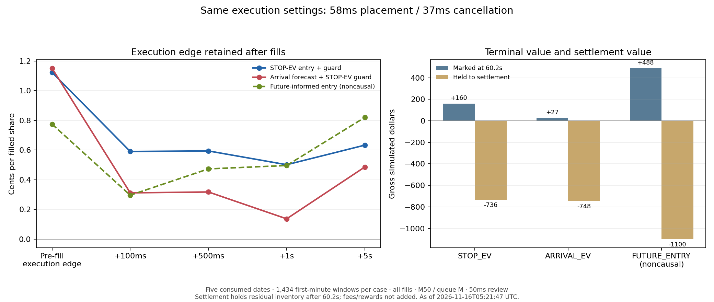

# Predict strategy scorecard

As of 2026-11-16T05:21:47.766093+00:00. Five consumed dates: 2026-10-27, 10-31, 11-01, 11-02, 11-03. Each case covers 1,434 first-minute windows; six Oct31 boundary windows excluded. All fills retained. Gross simulated values, no fees/rewards added. Quoting stops at 60s; final cancel tail ends at 60.2s. Settlement means holding that residual inventory to the market’s recorded binary resolution, with no further trading.

Dollar columns below are **totals across the five dates**, not daily averages.
Cents per share are weighted by filled volume. See the permanent
[strategy guide](../STRATEGIES.md) for naming and future comparison records.

## What the common accounting shows

Research interpretation recorded after the user's November 16 review:
**separate short-horizon execution quality from the missing inventory-control
layer.** The replay uses no inventory cap or inventory-management mode
(`pf_stop_ev_latency.simulate`: cap=None, mode='none'), then passively holds
remaining inventory after the first minute. Negative settlement carry does
not invalidate the observed positive short-horizon markouts; whether an
inventory policy can preserve them as executable profit remains untested.

For prediction research, the immediate comparison is retained short-horizon
edge at realistic latency. ARRIVAL_EV's **0.137c/share is its one-second
markout**, not its initial spread capture: +1.151c initial edge plus
-1.014c subsequent midpoint movement leaves +0.137c. STOP_EV at the same
58/37ms clock retains +0.502c/share; zero_all retains +1.131c/share.
The same-clock baseline is the direct entry-policy comparison. Zero_all
also changes feed, cancellation and notification timing, so the entire gap
cannot be attributed to entry forecast error. These strategies generate
different fills; the comparison is not a matched-fill causal decomposition.
Keep the short-horizon forecast gap as the prediction priority and retain
inventory management as a separate untested task. No new experiment or
change to the frozen numerical results accompanies this interpretation.

1. **The positive STOP_EV result was marked P&L, not settlement profit.** At
   recorded58, spread capture is +1.124c/share, +1s markout is +0.502c/share,
   and terminal P&L is +$159.56. Holding the final inventory to resolution
   contributes -$895.54, leaving settlement P&L of -$735.99. Even zero_all
   changes from +$820.92 marked to -$307.49 settled. These simulations do not
   establish profitable passive holding to settlement. They also do not test
   an active unwind or continued quoting after the first minute.
2. **The arrival forecast has not improved fill quality.** At the same
   recorded58 clock, it captures a similar initial edge (+1.151c/share), but
   retains only +0.137c/share after one second, versus STOP_EV's +0.502.
   Its smaller volume alone does not explain the lower marked profit.
3. **A large initial spread is insufficient.** FILL_GUARD and SWEEP_GUARD
   capture +2.928 and +3.290c/share at legacy40, but have negative one-second
   markouts. SWEEP_GUARD's +$61.88 settlement result comes from +$867.39 of
   inventory carry offsetting -$805.51 of terminal P&L; it does not show
   superior short-horizon execution quality.
4. **Churn and sparse two-sided quoting remain visible.** At recorded58,
   STOP_EV has any live quote for 23.01% of the quoting interval and both
   sides for 3.37%; ARRIVAL_EV has 26.78% and 3.25%. ARRIVAL_EV submits
   245,475 orders for 26,519 filled shares, versus 189,968 submissions for
   48,173 shares with STOP_EV. These measures distinguish market presence,
   submissions and filled volume instead of combining them as “uptime.”

The useful distinction is short-horizon execution edge, terminal portfolio
value, and the subsequent inventory outcome. An economic comparison needs
all three and an explicit exit policy. None of these consumed-data results
selects a new strategy or verifies the simulator's physical fill assumptions.

## Names: strategy and execution settings are separate

| Strategy ID | Plain name | Entry | Resting-order decision | Former name |
|---|---|---|---|---|
| KEEP_ALL | Always-rest ladder | Post whenever the shared ladder permits | No learned cancellation; shared structural handling remains | KA |
| FILL_GUARD | Fill-probability guard | Wait when fresh P(fill) exceeds the saved threshold | Pull when P(fill) exceeds the saved threshold | QR |
| SWEEP_GUARD | Sweep-risk guard | Wait when predicted through-price risk is too high | Pull the order when its depth-adjusted sweep risk is too high | MD1000 |
| ORDER_EV | Order-state EV | Post at nonnegative fresh EV | Pull at negative resting EV | B2 |
| STOP_EV | STOP-EV strategy | Post at nonnegative fresh EV | Pull at negative resting EV | EV / baseline |
| ARRIVAL_EV | Arrival forecast + STOP-EV guard | Post when forecast of same-price arrival teacher value is nonnegative | Unchanged STOP-EV negative-value pull rule | forecast |
| FUTURE_ENTRY | Future-informed entry diagnostic | Post using future information; NONCAUSAL diagnostic | Unchanged STOP-EV negative-value pull rule | arrival_oracle |

STOP-EV v3 is the **model**. STOP_EV is one **strategy using that model** for both entry and cancellation. FILL_GUARD uses only its fill head. ARRIVAL_EV replaces entry and keeps the STOP_EV cancellation rule. FUTURE_ENTRY uses future information and is not deployable. ORDER_EV is the separate order-state-only model.

The earlier STOP-EV-PLAY v2 / QR replay is **FILL_GUARD_250_RECALIBRATED**: 250ms decisions and separately calibrated thresholds. It is not the FILL_GUARD 50ms fixed-threshold case below. Older Huber/local one-second model tests are prediction diagnostics, not strategy P&L rows. Their negative selected-label sums must never be compared directly with this table.

| Clock ID | Place / cancel ms | Pending cancel / notice ms | Feed |
|---|---|---|---|
| legacy40 | 40 / 22 | 95 / 100 | recorded observation clocks |
| recorded58 | 58 / 37 | 95 / 100 | recorded observation clocks; deterministic recorded order medians |
| zero_orders | 0 / 0 | 0 / 0 | recorded observation clocks |
| zero_all | 0 / 0 | 0 / 0 | zero modeled feed delay; recorded events; 50ms grid remains |

Every case uses a 50ms review grid, M50 trade-time assumption, queue M with unknown-depth queue zero, six 30-share rungs per side, no inventory cap or fixed cooldown. Clock IDs are scenarios, not measured present production latency. Compare models within a clock block; compare clocks within STOP_EV. No new model or threshold was fitted.

## Metric definitions

All price references are YES-equivalent cents, with side sign +1 for buys and -1 for sells. Let q be filled shares, p the execution price, m0 the last valid book midpoint strictly before modeled fill time, mh the last valid midpoint at or before fill+h, and y the recorded settlement payout (0 or 1 dollars).

- **Spread capture / execution edge:** sum(q × side × (m0 − p))/100 dollars. This is an edge against the pre-fill public midpoint, not necessarily a matched round-trip spread or executable liquidation value.
- **Post-fill midpoint movement:** sum(q × side × (mh − m0))/100 dollars. Negative values measure adverse movement after fills; they are not mechanically deducted a second time.
- **Markout at h:** spread capture + post-fill midpoint movement = sum(q × side × (mh − p))/100 dollars. Report h=100ms, 500ms, 1s and 5s, in dollars and cents per filled share.
- **Terminal P&L:** cash + signed remaining inventory × midpoint at 60.2s. This is the number previously called P&L in the latency/arrival reports.
- **Settlement P&L:** cash + signed remaining inventory × y. **Settlement carry** = settlement P&L − terminal P&L. It isolates the effect of carrying the final inventory to resolution.
- **Quote availability:** fraction of the quoting interval with any physically live, unfilled order; “both” requires one on each side. Overlapping intervals are merged. This differs from summed per-rung exposure or keep-decision frequency.
- **Inventory:** time-weighted mean absolute inventory and maximum absolute inventory during replay. Different markets settle independently; their signed positions are not netted across windows.

Marks use the **modeled fill clock**, which is the recorded/imputed trade anchor minus 50ms in these cases. Previous reports used anchor+1s/5s; those old measures are retained separately in the CSV/JSON and must reproduce exactly. Missing required marks refuse the report; stale-mid shares are counted without dropping fills.

## Recorded-median execution: current entry comparison

| Strategy / clock | Shares | Spread c/sh | +1s c/sh | +5s c/sh | Terminal $ | Settlement $ | Settlement carry $ |
|---|---:|---:|---:|---:|---:|---:|---:|---:|
| STOP_EV / recorded58 | 48,173 | +1.124 | +0.502 | +0.633 | +159.56 | -735.99 | -895.54 |
| ARRIVAL_EV / recorded58 | 26,519 | +1.151 | +0.137 | +0.486 | +26.81 | -747.70 | -774.51 |
| FUTURE_ENTRY / recorded58 | 68,418 | +0.775 | +0.496 | +0.821 | +488.18 | -1099.83 | -1588.00 |

## Legacy execution: model/rule comparison

| Strategy / clock | Shares | Spread c/sh | +1s c/sh | +5s c/sh | Terminal $ | Settlement $ | Settlement carry $ |
|---|---:|---:|---:|---:|---:|---:|---:|---:|
| KEEP_ALL / legacy40 | 1,774,656 | +0.643 | -1.915 | -1.935 | -32408.51 | -46751.30 | -14342.79 |
| FILL_GUARD / legacy40 | 122,164 | +2.928 | -0.824 | -0.883 | -818.39 | -2432.51 | -1614.12 |
| SWEEP_GUARD / legacy40 | 79,323 | +3.290 | -1.260 | -1.136 | -805.51 | +61.88 | +867.39 |
| ORDER_EV / legacy40 | 7,848 | +1.309 | -1.998 | -2.213 | -219.70 | -493.54 | -273.84 |
| STOP_EV / legacy40 | 42,890 | +1.122 | +0.797 | +1.138 | +397.10 | -242.41 | -639.51 |

## Zero-delay STOP_EV diagnostics

| Strategy / clock | Shares | Spread c/sh | +1s c/sh | +5s c/sh | Terminal $ | Settlement $ | Settlement carry $ |
|---|---:|---:|---:|---:|---:|---:|---:|---:|
| STOP_EV / zero_orders | 69,439 | +1.009 | +0.940 | +1.271 | +642.44 | -1489.17 | -2131.61 |
| STOP_EV / zero_all | 85,402 | +1.010 | +1.131 | +1.413 | +820.92 | -307.49 | -1128.41 |

## Economic decomposition

| Case | Spread $ | Midpoint movement to +1s $ | +1s markout $ | +100ms c/sh | +500ms c/sh |
|---|---:|---:|---:|---:|---:|
| KEEP_ALL__legacy40 | +11408.31 | -45390.61 | -33982.30 | -0.821 | -1.702 |
| FILL_GUARD__legacy40 | +3577.43 | -4583.76 | -1006.33 | +1.573 | +0.075 |
| SWEEP_GUARD__legacy40 | +2609.93 | -3609.16 | -999.23 | +1.328 | -0.284 |
| ORDER_EV__legacy40 | +102.72 | -259.54 | -156.82 | -0.628 | -1.737 |
| STOP_EV__legacy40 | +481.41 | -139.46 | +341.95 | +0.670 | +0.846 |
| STOP_EV__recorded58 | +541.41 | -299.78 | +241.63 | +0.591 | +0.594 |
| ARRIVAL_EV__recorded58 | +305.32 | -269.02 | +36.31 | +0.312 | +0.318 |
| FUTURE_ENTRY__recorded58 | +530.08 | -190.50 | +339.58 | +0.296 | +0.473 |
| STOP_EV__zero_orders | +700.48 | -47.94 | +652.55 | +0.635 | +0.932 |
| STOP_EV__zero_all | +862.36 | +103.15 | +965.51 | +0.752 | +1.111 |

## Activity and inventory

| Case | Orders / guard pulls | Filled orders % | Any / both quote % | Mean / max abs inventory | Terminal / settlement positive dates |
|---|---:|---:|---:|---:|---:|
| KEEP_ALL__legacy40 | 206,186 / 0 | 34.49 | 99.88 / 99.51 | 207.0 / 1368.9 | 0/5 / 0/5 |
| FILL_GUARD__legacy40 | 243,511 / 150,418 | 2.09 | 99.82 / 96.26 | 30.9 / 628.5 | 2/5 / 1/5 |
| SWEEP_GUARD__legacy40 | 305,424 / 223,025 | 1.07 | 99.44 / 91.86 | 20.3 / 384.0 | 0/5 / 3/5 |
| ORDER_EV__legacy40 | 19,100 / 17,625 | 1.97 | 8.13 / 2.48 | 2.3 / 185.9 | 1/5 / 0/5 |
| STOP_EV__legacy40 | 201,731 / 187,565 | 1.02 | 20.69 / 2.69 | 12.5 / 936.6 | 4/5 / 3/5 |
| STOP_EV__recorded58 | 189,968 / 174,669 | 1.21 | 23.01 / 3.37 | 13.3 / 919.8 | 4/5 / 2/5 |
| ARRIVAL_EV__recorded58 | 245,475 / 227,546 | 0.52 | 26.78 / 3.25 | 7.8 / 842.0 | 2/5 / 2/5 |
| FUTURE_ENTRY__recorded58 | 329,158 / 194,447 | 1.03 | 25.19 / 3.52 | 18.1 / 1297.0 | 4/5 / 0/5 |
| STOP_EV__zero_orders | 220,999 / 204,953 | 1.47 | 24.70 / 3.75 | 18.1 / 1341.9 | 5/5 / 2/5 |
| STOP_EV__zero_all | 225,323 / 208,201 | 1.77 | 25.05 / 3.86 | 21.9 / 1579.7 | 3/5 / 2/5 |

Submissions include rejected placements; filled-order fraction counts orders
with at least one fill divided by submissions. The historical `pulls` field
counts guard-triggered pulls, excluding routine price-management and final
cancellations. Availability includes executable orders awaiting cancellation.

## Attribution and mark coverage

| Case | Terminal excluding <100ms fills $ | WS / E2 terminal $ | Pending-cancel volume % | Pre-fill midpoint older than 1s: shares |
|---|---:|---:|---:|---:|
| KEEP_ALL__legacy40 | -29225.10 | -15631.94 / -16776.57 | 3.37 | 90.00 |
| FILL_GUARD__legacy40 | -891.64 | +146.45 / -964.84 | 15.73 | 0.00 |
| SWEEP_GUARD__legacy40 | -751.01 | -113.26 / -692.24 | 14.05 | 0.00 |
| ORDER_EV__legacy40 | -73.98 | -142.63 / -77.07 | 32.56 | 0.00 |
| STOP_EV__legacy40 | +213.33 | +61.52 / +335.58 | 20.94 | 0.00 |
| STOP_EV__recorded58 | +30.19 | +28.21 / +131.34 | 23.51 | 0.00 |
| ARRIVAL_EV__recorded58 | -32.46 | -78.29 / +105.10 | 22.10 | 0.00 |
| FUTURE_ENTRY__recorded58 | +64.85 | +162.56 / +325.62 | 19.28 | 0.00 |
| STOP_EV__zero_orders | +276.08 | +254.40 / +388.04 | 0.00 | 0.00 |
| STOP_EV__zero_all | +341.31 | +298.72 / +522.20 | 0.00 | 0.00 |

These are additive fill partitions, not reruns that remove those fills. Full age/source/horizon coverage, per-day values, gross fill ledgers and hashes are retained in the artifacts.

## Per-date terminal / settlement dollars

| Case | Oct27 | Oct31 | Nov1 | Nov2 | Nov3 |
|---|---:|---:|---:|---:|---:|
| KEEP_ALL__legacy40 | -6034.75 / -8644.09 | -5872.26 / -7492.27 | -6625.54 / -8207.62 | -5861.06 / -10745.20 | -8014.90 / -11662.12 |
| FILL_GUARD__legacy40 | -155.10 / -332.97 | +39.71 / -398.40 | +38.78 / +417.73 | -211.85 / -1015.37 | -529.92 / -1103.50 |
| SWEEP_GUARD__legacy40 | -222.09 / -105.74 | -147.29 / -208.91 | -100.59 / +226.83 | -189.85 / +88.79 | -145.69 / +60.92 |
| ORDER_EV__legacy40 | -117.70 / -184.21 | -71.82 / -175.60 | -15.38 / -4.55 | -18.13 / -86.65 | +3.34 / -42.53 |
| STOP_EV__legacy40 | +197.70 / -260.05 | -59.99 / +128.16 | +127.77 / -485.34 | +75.76 / +225.27 | +55.86 / +149.55 |
| STOP_EV__recorded58 | +200.40 / -201.71 | +9.39 / +70.80 | +11.32 / -575.55 | -62.87 / -44.99 | +1.32 / +15.46 |
| ARRIVAL_EV__recorded58 | +134.82 / -501.18 | -46.39 / +80.51 | +43.23 / -189.87 | -74.43 / +26.71 | -30.43 / -163.87 |
| FUTURE_ENTRY__recorded58 | +400.04 / -189.82 | +53.20 / -321.86 | +110.43 / -317.04 | -89.53 / -165.19 | +14.03 / -105.92 |
| STOP_EV__zero_orders | +395.55 / -357.62 | +4.90 / +113.58 | +68.49 / -1330.52 | +153.54 / +421.87 | +19.96 / -336.49 |
| STOP_EV__zero_all | +535.95 / +125.85 | +101.45 / +815.35 | +230.31 / -587.70 | -8.37 / -135.19 | -38.42 / -525.79 |

## Checks, provenance and interpretation limits

All 14,340 strategy-window reproductions pass against their named previous artifacts, including existing terminal values, shares, order/pull counts, fill counts, inventory maxima, exposure, age/source splits and old anchor markouts. Every fill ledger reconciles to portfolio cash/inventory and settlement; pre-fill timing, bid/ask signs, overlap-safe availability and known-bad controls pass.

The independent [raw-source audit](../reviews/strategy_scorecard_20261116/results_v1/audit_v1.json)
completed at 2026-11-16T05:22:42.399902+00:00. It verifies all **259,723 fill
records**, 124 book-file identities and five outcome registries, recomputing
the pre-fill reference, four markouts, terminal value and separate Up/Down
token payouts. Deliberately corrupted timestamps, signs, marks, outcomes and
token mappings are refused. The
[source/age table](../reviews/strategy_scorecard_20261116/results_v1/source_age_attribution.csv)
includes fill counts, shares and value attribution.

During audit development, the first attempt stopped because the checker
treated scalar `up_index` as a list. The checker now asserts the recorded
integer mapping and tests bad mappings explicitly. No frozen scorecard
source, replay ledger or result was changed by that checker correction.

Settlement can be dominated by a few inventory outcomes. It is a separate endpoint, not a substitute for fill quality. Day dispersion and worst-window values are included in JSON/CSV; no confidence interval, significance claim, selection of a new policy, untouched validation, or live-profit claim is made. Queue/timing assumptions and public-book counterfactual fills remain unvalidated; simulated volume and dollars can be inflated. No M0/M250/queue-L robustness reruns are added.

Canonical registry: `predictfun/reviews/strategy_scorecard_20261116/freeze_v1.json`. Results: `results_v1/report.json`, `strategy_totals.csv`, `strategy_by_day.csv`. Fill and window ledgers: `data/predict_fun/research/strategy_scorecard_20261116_v1/`. Historical result files are unchanged. Always cite strategy ID + clock ID + mark horizon + included fill population.
