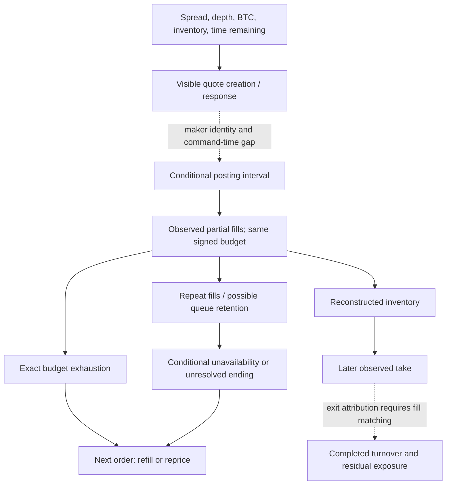

# Maker action and logic chains — current evidence

Built across **all 88 fixed signed-order chains**, not selected anecdotes. Consumed Oct24–27; as of 2026-11-24T04:18:56Z. We can reconstruct portions of the sequence and some repeated market-condition associations. We have not identified a complete private maker controller. Counts below are this selected chain sample, not unconditional action rates.

## What the new population reconstruction adds

| Chain component | Result | Meaning |
|---|---:|---|
| Multiple fills on one signed order | 25/88 | The original size persists and successive fills consume its remaining budget. This is compatible with retaining priority, not proof of uninterrupted rest. |
| Observed budget exhaustion | 41/88 | No terminal pull is needed to explain these endings. |
| Conditional unavailability | 40/88 | Positive budget remains; unavailability timing requires the declared completeness/priority/reservation premises. Seven further orders remain unresolved. |
| Successor definitely after old ending under windows | 7/88 | 3 exhaustion→same-price refill, 2 exhaustion→reprice, 2 conditional ending→reprice. These are sequence estimates, not identified intent. |
| Successor timing overlaps | 35/88 | Sequential replacement and already-resting/overlapping quotes remain compatible. A later first fill cannot decide between them. |
| Existing successor but unusable window | 7/88 | No ordered-chain claim. |
| No recorded successor | 39/88 | Unfilled successors are not visible; this is not evidence no further order was posted. |
| Later take after the last maker fill | 81 references to 68 distinct takes | An observed later action of the same maker. It is not automatically this order's exit or an inventory reduction. |

Two additional ending upper bounds tighten. Posting bounds do not improve. There are zero new private-pull identifications and zero exhausted-order false pulls. The between-fill test has **zero timing-separated opportunities**: no competing record has a hard window strictly between two own fill windows. Its zero contradictions therefore says nothing about continuous queue retention.

## Condition → action logic we can currently support

These repeated associations come from the prior independently checked **neutral populations** (17,100 maker-seconds;11,400 market-side seconds), not a regression over the 88 filled orders. All64 comparisons remain available in [the full evidence map](../maker_condition_action_20261124/outputs/overview.csv); these rows explain the sequence without upgrading the original verdicts.

| Condition | Observed action pattern | Strength and actor gap |
|---|---|---|
| Wider spread | More fresh quote levels appear: matched ratio1.36,1.10 with1s state lag | Repeatable anonymous market quoting association; not attributed to a particular top maker. |
| Thin own touch depth | More fresh levels overall (ratio1.12 at both clocks), but fewer same-side restorations after a retreat | Different opportunity definitions produce different behaviors; thin depth is not a universal refill trigger. |
| Own maker fills accumulate | More opposing takes in the original comparison; the more tightly matched sequential result weakens with1s lag | Plausible passive-fill→inventory→take link, timing-sensitive. |
| Large absolute reconstructed inventory | Fewer same-direction takes (ratio0.51); no demonstrated increase in opposing takes (0.91) | Better evidence for restraining further exposure than automatically liquidating a large position. |
| Last30s | More deep fresh levels (ratio7.60), fewer takes (any-take0.29) | Placement is anonymous; takes are maker-attributed. No general aggressive flatten-at-expiry rule is established. |
| BTC reversal / adverse BTC | Some conditional endings are compatible, but prior post-before-reversal test was not demonstrated | No reliable “BTC reverses → this maker cancels” rule yet. The current physical reconstruction does not change that conclusion. |

The emerging working chain is: **quote in response to an opportunity; allow the same order budget to execute repeatedly; after depletion, sometimes replenish or reprice; manage resulting inventory using both passive and aggressive actions.** The quote-maker identity, continuous queue position and cause of withdrawal remain estimated or missing. This is a hypothesis structure supported to different degrees at each link, not an executable profitable strategy.

## Every ordered successor chain (all seven, no outcome selection)

Times below are seconds from that market's start. Size shows original / recorded filled shares. BTC and inventory are ranges over the entire successor posting window on the saved1s as-of grid; mixed categories mean timing uncertainty. D0 / lag1s are both shown. Inventory is reconstructed venue exposure, not private client state.

| Day / market / maker rank | Old hash | Size / filled | Ending | Ending interval | Next action candidate | Next posting interval | BTC side D0 / lag1s | Inventory side D0 |
|---|---|---|---|---|---|---|---|---|
| 20261024 / 3697902 / #1 | 0x2c037693ba | 30 / 30.00 | exhausted | 206.695–208.695s | refill same_price | 210.872–211.165s | flat / flat | adding |
| 20261024 / 3704004 / #2 | 0xda08d7801c | 50 / 50.00 | exhausted | 215.428–217.428s | refill same_price | 217.878–219.840s | flat / flat | offsetting |
| 20261025 / 3734864 / #1 | 0x4be0f8768c | 30 / 30.00 | exhausted | 36.323–38.323s | reprice more aggressive than old quote | 40.976–41.558s | flat / flat | offsetting |
| 20261025 / 3737919 / #1 | 0xf0469b20c7 | 30 / 30.00 | exhausted | 214.584–216.584s | reprice more aggressive than old quote | 216.966–219.406s | flat / flat | adding |
| 20261026 / 3789484 / #1 | 0x3be8243bef | 50 / 10.00 | conditional_unavailable | 269.035–271.500s | reprice less aggressive than old quote | 272.947–274.993s | against / against | offsetting |
| 20261026 / 3803131 / #1 | 0x45091f5e42 | 50 / 50.00 | exhausted | 272.543–274.543s | refill same_price | 277.109–277.419s | flat / flat | offsetting |
| 20261027 / 3877472 / #1 | 0x714e35d667 | 160 / 11.36 | conditional_unavailable | 34.339–36.349s | reprice less aggressive than old quote | 37.197–39.173s | against, flat / against, flat | adding, offsetting |

These rows answer “what sequence and what conditions are compatible?” They do not establish why an individual decided to act. Original size of a successor is unknown unless that successor itself has signed evidence. The price-direction labels compare the two quotes only. A lower bid or higher ask can simply follow a moving market. They do not measure distance from the contemporaneous spread; the separate comparison below does.

## Where the inference still breaks

- **Posting identity/time:** anonymous additions cannot reliably identify which maker posted, and first fill is still the posting upper bound.
- **Queue continuity:** repeated hashes and positive remainders do not rule out off-chain removal/reentry or transient reservations.
- **Pull vs reservation:** insufficient saved pending quantity is evidence under a scenario; hidden/failed/coalesced reservations remain possible.
- **Replacement vs ladder:** overlapping posting/ending windows cannot identify intent.
- **Take vs exit:** subsequent takes need exact inventory/lot attribution before calling them an unwind of these fills.

The next useful measurement is a **coverage-gated expansion of signed order chains**, aimed at testing depletion → same-side refill/reprice against partial-fill controls. First count unused existing top-maker hashes with signed terms, complete fill membership and usable successor windows; freeze selection without BTC, inventory or profit outcomes. If the census cannot add timing-identifiable chains, stop. Any full build must fit a declared resource budget; new source acquisition or a cap increase needs separate authorization. Another anonymous book sample does not solve maker identity.

## All successor links, including ambiguous timing

Post-run descriptive grouping of the existing88 rows; no new test or selected threshold. Every cell, including no successor, is in [population_chain_counts.csv](population_chain_counts.csv).

| Ending group | Scope | Orders | Same price | More aggressive price | Less aggressive price | Unknown |
|---|---|---:|---:|---:|---:|---:|
| exhausted | all_existing_links | 20 | 3 | 4 | 13 | 0 |
| exhausted | ordered_after_only | 5 | 3 | 2 | 0 | 0 |
| conditional_withdrawal | all_existing_links | 26 | 0 | 4 | 22 | 0 |
| conditional_withdrawal | ordered_after_only | 2 | 0 | 0 | 2 | 0 |
| unresolved | all_existing_links | 3 | 0 | 0 | 3 | 0 |
| unresolved | ordered_after_only | 0 | 0 | 0 | 0 | 0 |

A direction is observable for the linked price; timing and replacement intent remain separately graded. This table does not convert ambiguous successors into post-ending commands. The seven ordered cases suggest candidate branches to test—replenish/reprice after depletion and retreat after a conditional ending—but the sample is too thin to establish a general maker rule.

## Does repricing follow the market, or retreat from it?

This extension was declared after the primary chain counts, before measuring the following quantities. It compares every feasible sampled ending state with every feasible sampled successor-post state, at current and lagged clocks. Values are cent ticks relative to the own-side best; all combinations are retained. The saved one-second grid is a proxy, not continuous observation of a private decision.

| Scope | Usable pairs | Less aggressive relative to touch, D0 / lag1s | More aggressive, D0 / lag1s | Timing ambiguous, D0 / lag1s |
|---|---:|---:|---:|---:|
| Exhausted orders | 19 | 2 / 2 | 3 / 5 | 14 / 12 |
| Conditional endings | 23 | 3 / 4 | 0 / 0 | 20 / 19 |
| Total | 42 | 5 / 6 | 3 / 5 | 34 / 31 |

Seven further successor windows are refused; 39 orders have no recorded successor. These are not counted as stable prices or absent actions. For conditional endings, 22 of the 26 linked quotes have a less aggressive *absolute price*, but only three of the 23 usable window comparisons consistently retreat relative to the touch at D0. **We cannot treat the price change alone as a deliberate risk retreat.**

All seven time-ordered chains, with the relative-touch comparison:

| Old hash | D0 | Lag1s |
|---|---|---|
| 0x2c037693ba | more aggressive relative touch | more aggressive relative touch |
| 0xda08d7801c | timing ambiguous | timing ambiguous |
| 0x4be0f8768c | more aggressive relative touch | more aggressive relative touch |
| 0xf0469b20c7 | more aggressive relative touch | more aggressive relative touch |
| 0x3be8243bef | timing ambiguous | timing ambiguous |
| 0x45091f5e42 | timing ambiguous | more aggressive relative touch |
| 0x714e35d667 | timing ambiguous | timing ambiguous |

Exact rows and statuses: [quote_relative.csv](outputs/quote_relative.csv). Independent scalar reconstruction matches all176 order/clock rows; five planted corruptions are refused. These remain descriptive chain estimates on consumed days, with no claimed new profitable rule.
