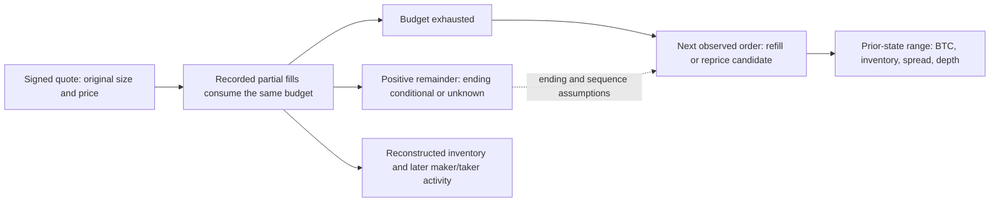

# Action first, then market conditions — completed

2026-11-24; as of 2026-11-24T04:49:57Z. [Physical-stage contract](contract.md), [reference amendment](reference_contract.md). Primary freeze **520f7227f8956e21c080b4470206f76a5b0315d2**, reference freeze **84a4600e3ca394efb7b6deb313821330ee43ee29**. All four dates Oct24–27 are consumed development days. Zero new model candidates, no validation/profitability claim, no network or simulator change.

The new packet expands the signed action population from88 to **146 hashes** using already saved transaction receipts. It reconstructs actions without reading market features, writes and hashes that table, and only then annotates the possible action windows. Independent checks verify that state mapping leaves physical labels unchanged.

## Reconstructed actions

- **58 hashes new to the88-order packet:** 37 exhausted,9 with positive remaining budget,12 with incomplete recorded history.44 of these58 have usable posting windows and complete pure-maker history. These are new reconstructed cases, not new market days or newly collected data.
- **All146:** 78 exact signed-budget exhaustions,56 positive remainders,12 incomplete histories. Among the56 remainders,40 retain the old conditional-unavailability bounds;16 have no identified ending. A positive remainder is not a cancellation.
- **30 successors follow an ending under the time bounds:** 22 after exhaustion (7 same-price refill,15 reprice) and8 after inherited conditional unavailability (1 refill,7 reprice). Nine of these30 come from the added hashes:2 refill and7 reprice, all after exhaustion.
- Other successor statuses:47 overlapping/ambiguous,32 unavailable timing,37 no recorded successor. None of these proves WAIT or no posting.

**Important comparison convention:** this packet uses the pre-existing `post_fill.next_hash` candidate for every order. The earlier88-chain packet used the pull-table successor. Therefore30 versus the previous7 is **not** an improvement from new information alone;21 of the30 involve the old88 under the different, explicitly frozen link convention. Nine are additional cases. All sequences remain candidate relationships rather than identified replacement intent.

Exact rows: [orders.csv](outputs/orders.csv), [all30 ordered chains](outputs/ordered_chains.csv). The30 links span 15 markets, with day counts {'20261026': 5, '20261024': 15, '20261025': 8, '20261027': 2}. Related orders share transactions and markets. The cache was acquired around earlier filled/terminal examples; this is not a random sample of maker decisions.

## Mapping the actions to conditions

Every post, ending and successor window has D0 and lag1s annotations: **876 rows**, including unknown/refused cases. Whole feasible windows are retained, not a midpoint picked to fit a story. Inventory is reconstructed venue exposure, not a private client's known inventory. The saved one-second grid can miss intrasecond changes.

In the30 ordered successor windows,23 remain BTC-flat at both clocks. To avoid treating a common market state as an action trigger, a separate adaptive amendment froze an equal-window market-time benchmark before computing it: same maker/market/side, same sampled duration and same elapsed-market phase. It enumerates12,127 reference windows and generates500 diagnostic draws per case/clock. The exact uniform expectation, rather than a selected draw, is the comparison below.

| Condition over the successor posting window | Observed D0 | Matched market-time D0 | Observed lag1s | Matched market-time lag1s |
|---|---:|---:|---:|---:|
| BTC flat | 23/30 (76.7%) | 24.61/30 (82.0%) | 24/30 (80.0%) | 24.62/30 (82.1%) |
| BTC against quote side | 1/30 (3.3%) | 0.93/30 (3.1%) | 1/30 (3.3%) | 0.93/30 (3.1%) |
| Quote side offsets reconstructed inventory | 15/30 (50.0%) | 12.97/30 (43.2%) | 14/30 (46.7%) | 12.93/30 (43.1%) |
| Quote side adds to reconstructed inventory | 12/30 (40.0%) | 13.76/30 (45.9%) | 10/30 (33.3%) | 13.70/30 (45.7%) |
| Spread stays below two ticks | 26/30 (86.7%) | 22.78/30 (75.9%) | 25/30 (83.3%) | 22.74/30 (75.8%) |
| Own touch depth stays above 200 shares | 9/30 (30.0%) | 6.94/30 (23.1%) | 7/30 (23.3%) | 6.94/30 (23.1%) |

All48 category/clock rows, including mixed and unknown categories, are in [reference_comparison.csv](outputs/reference_comparison.csv). These references are **market times, not observed non-actions**. They may contain unseen/unfilled posts. Only market identity, side, duration and elapsed phase are matched; the table does not control all other state variables or queue position. Draws are implementation/reference diagnostics, not day-cluster confidence intervals or p-values.

The check changes the interpretation: calm BTC is common in the matched market time too, so the high raw calm count does not establish a calm-BTC repost trigger. Offsetting inventory is modestly more common around the observed successor actions, with a smaller excess after lagging the state; it remains a hypothesis. Tight spread is more frequent than the phase-matched benchmark in these successor windows. This concerns maintenance/replenishment after a prior order, and must not be conflated with the older anonymous fresh-level/wider-spread population. No per-field difference is a demonstrated causal or profitable rule.

## Whole chain and remaining identification boundary

This strengthens the mechanically identifiable depletion→replenishment/reprice chain. It does not recover a complete private posting/pulling policy. Exact private submission/cancellation commands, no-action exposure, uninterrupted queue priority and per-order pending allocation remain unknown. We therefore did **not** run or claim a posting/non-posting propensity test; its control-observability gate failed. Expanding fill-selected cases cannot by itself fix that gate.

## Verification, resource and deferred work

14 initial synthetic groups pass. Independent checks reparse218 raw signed fill events, reconcile241 saved feed legs, all146 action rows and876 state rows, and refuse9 planted corruptions. The market-time reference has four boundary/category groups and a separate scalar enumeration of every reference window; five real-copy corruptions are refused. The same accepted ABI decoder is reused for hashing/calldata; raw event accounting and action/state reconstruction are independently checked. No failed run in this round. No frozen predecessor file changed.

The raw-to-derived hashes are in census.json; compact evidence copies are included under evidence/. Sources and receipts are bound in manifest.json and reference_bindings.json; final hashes in SHA256SUMS. Packet cap .004core-hours (14.4CPU seconds), unchanged task2.00/line5.30 with .05reserve; measured all-attempt usage is in resource_final.json. Existing unrelated changes are preserved; local commits only.

Minor source-format cleanup is deferred. The material limit is action observability and selection, not a failed implementation check. Proven exhaustion, conditional unavailability and incomplete history remain distinct throughout.

## ONE next priority

One action-choice study on the full already accepted next-order census: classify each observed same-side successor as same-price, more-aggressive-price or less-aggressive-price using identity/price only; retain posting-window grades. Compare these observed action types, with all feasible prior-state values, matching maker/market, starting price position and time remaining. This avoids inventing WAITs from missing fills. Freeze the action population and a support/runtime gate before condition results; if support is thin, stop without fitting a rule. A full run must fit the remaining resource allowance or receive a USER-approved top-up; no new days or live use are authorized here.
