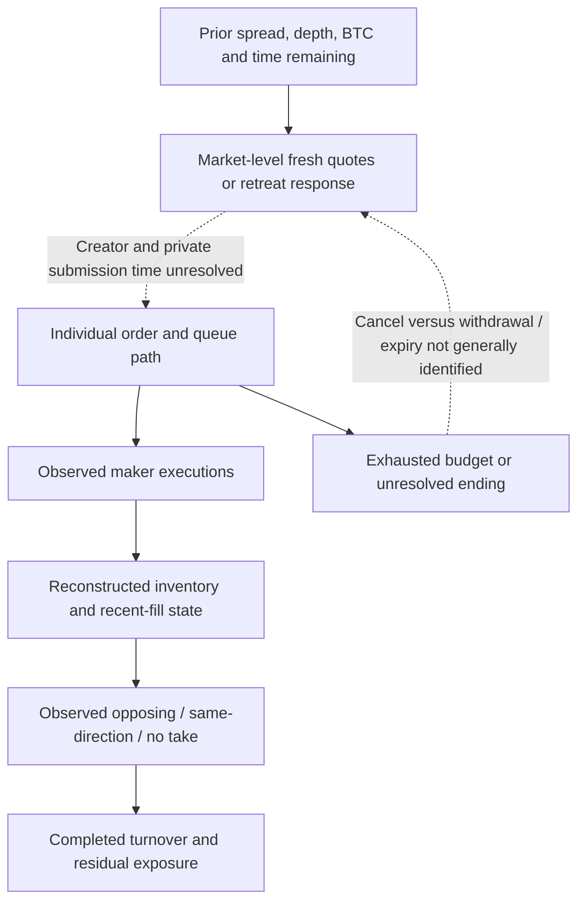

# CONDITION-ACTION-CHAIN-MAP-v1 — whole-population results

2026-11-24. USER: “We are not checking a few examples, we want to figure out the logic chains and corresponding actions given market conditions.” This packet changes the unit of work accordingly. It supersedes the prior handoff's priority to focus only on the 47 unresolved terminal examples. Freeze **02ceb47486928b91c6d78c2df32375f090ed22cc**; [contract](contract.md), [manifest](manifest.json), [independent checks](checks.json).

## Scope and result

We now have a single population-level condition/action map, with every comparison retained:

- **17,100 maker-seconds:** all three preselected volume-ranked makers × all 19 BOOK markets × each of the 300 seconds, including no-take seconds.
- **11,400 market-side seconds:** both sides of those same markets, including no-creation seconds.
- The **3,796 retreat/response episodes** from the accepted competing-transition study.
- **64 condition/action comparisons**, represented by 224 clock/panel rows; 7,164 descriptive joint-state cells and 90 new matched sequential-contrast rows.
- Four consumed days, Oct 24–27; as-of 2026-11-24T02:31:19Z. No independent-day intervals, new model, validation, profit or causal-policy claim.

The old matched effects, 500-shift controls and original verdicts are preserved. New work connects prior passive-fill activity with inventory/BTC/time state and next-second take direction on the full neutral panel. It does not infer a private quote or pull from a fill.

## The condition-to-action map

Every comparison and denominator is in [evidence_map.csv](outputs/evidence_map.csv); [overview.csv](outputs/overview.csv) carries all 64 primary rows and their timing/panel ranges. These illustrations are selected for explaining the chain, not a new selected hypothesis set. Raw rates and matched effects are different estimands; do not divide the raw rates to reproduce a matched effect.

| Prior condition | Corresponding observed behavior | Matched result | What it supports |
|---|---|---|---|
| Spread at least two ticks versus one | A fresh price level appears on the side | Rate ratio **1.36**, **1.10** with state lagged 1s. Raw 882/1,116 versus 4,054/10,262 seconds. | Wider spread is associated with more observable quoting activity at new price cells. **Anonymous market layer**, not an identified top-maker posting rule. |
| Own best depth 0–50 versus >200 shares | More fresh levels | Ratio **1.12** at both clocks; raw rates 60.76%/36.74%, n=2,393/6,048. | Depth matters to visible placement behavior. It does not identify individual queue entry or size added at occupied levels. |
| One-side retreat, with thin prior own best depth | Fewer next changes are same-side responses | **−9.69 percentage points** D0; **−11.21** lagged. Common comparison n=886/212. | Thin touch is not a universal “immediately refill this side” rule. The competing next event matters. |
| At least three prior own maker fills in 5s versus none | More opposing takes | Original TAKE matched ratio **1.42**; raw 8.43%/4.09%, n=5,163/5,595. | Candidate link from passive executions to inventory management; the stronger market-matched test below weakens its timing robustness. |
| Absolute inventory >200 versus (0,50] shares | Fewer same-direction takes; no demonstrated rise in opposing takes | Same-direction ratio **0.51** (six-view range 0.44–0.58); opposing **0.91** (0.90–0.93). | The observed behavior is more consistent with **restraining further exposure** than an automatic large-position liquidation trigger. These directions do not prove intent. |
| Last 30s versus (60,240]s remaining | More deep fresh levels, but fewer takes | Deep-level ratio **7.60** (lagged 7.49); any-take **0.29** (six-view range 0.29–0.34); opposing-take **0.44**. | Distinct late-market behavior. The data do **not** support “makers generally flatten aggressively at expiry.” Placement is anonymous; taking is maker-attributed. |
| BTC moving with/against current exposure | No stable simple take-profit/stop-loss take rule | With-inventory opposing-take ratio spans **0.95–1.21**; adverse-BTC original opposing ratio **0.73**, without the original positive-support verdict. | Do not turn BTC direction alone into an inferred maker take trigger. Absence of a demonstrated rule is not evidence BTC is ignored. |
| Adverse BTC relative to a book side after retreat | More same-side market responses in the matched population | **+3.10/+3.14 points**, positive all four days at both clocks in the accepted study. | A market-layer association, concentrated in one market's net contribution. It is not proof that one maker pulls/reposts when BTC reverses; the unmatched population has the opposite sign. |

For take ratios below one, the inherited `verdict_rule` tests positive elevation and often says `not_supported`; the table above states the observed lower directions and six-view ranges without relabelling that verdict as new statistical support. The new joint-state census has no permutation test or significance claim. Market-cell creation also misses additions at already occupied prices and contains anchor-straddling timing limitations documented by the prior review; it is not a complete posting census.

## New bridge: passive executions → inventory state → subsequent taking

At each neutral maker-second, the pre-anchor state is the saved reconstructed inventory, five-second BTC direction aligned to that inventory, time remaining and count of prior maker fills. The outcome is the accepted next-second recorded take schedule. We compare burst (>=3 fills) versus zero, matching **within day × market × maker rank × inventory band × BTC band × time-left band**. Middle burst counts, zero inventory and missing BTC are counted separately in [exclusions.csv](outputs/exclusions.csv). No-event seconds remain.

Full D0 common support contains **3,739 burst seconds / 4,075 reference seconds**, 297 strata, all 19 markets. Opposing takes occur in **300 / 207** of those seconds. Harmonic stratum weighting gives **+1.092 points**, rather than the raw rate difference. Same-direction takes give **−0.174 points**; any-take gives **+0.995 points**. Largest-market share of absolute opposing-take contribution is 13.9% pooled, but Oct 27 contains only two markets and its within-day concentration is much higher.

| State convention | Opposing-take matched difference, full / clean | Day signs, full |
|---|---:|---|
| D0 prior state | **+1.092 / +1.198 points** | 4 positive, 0 negative |
| Whole state lagged 1s | **+0.126 / +0.223 points** | 2 positive, 2 negative |
| Pending-fill sensitivity | **+1.183 / +1.402 points** | 3 positive, 1 negative |

D0 day differences are +0.576 / +1.289 / +0.353 / +5.162 points. The new sequential link is **timing-sensitive descriptive evidence**, not a robust causal rule. “After passive fills, take to reduce” is an economic hypothesis worth retaining, but this packet does not establish the exact response latency or a deployable trigger. An opposing take refers to reconstructed anchor exposure; it is not automatically a reduction of private decision-time inventory. Opposing and same-direction events can coexist in one second and cannot be summed as disjoint actions.

[sequence_contrast.csv](outputs/sequence_contrast.csv) contains every day, clock, panel, denominator and concentration. [joint_states.csv.gz](outputs/joint_states.csv.gz) contains all state cells, including zero-event and thin cells; no cells were selected for fitting a rule. Four-day dependence and repeated seconds remain; these are not 17,100 independent decisions.

## Whole logic chain, with the actor join made explicit

This graph expresses what can and cannot be joined in the existing records. The complete observed population supports a working economic chain: **respond to available quoting opportunities, accumulate or offset exposure through passive executions, restrain additional exposure as inventory grows, sometimes trade aggressively after fills, and alter behavior near market end.** It does not establish that the same maker caused an anonymous creation, why it cancelled, or how it first acquired queue priority. The economic attribution from earlier accepted work concerns actual completed turnover and residuals; action rates alone do not show profitable replication.

The new signed-order evidence narrows the ending ambiguity: 41 of 88 fixed terminal samples fully exhaust their original budget, while 47 remain unresolved. This is a separate stratified, fill-selected sample, not the neutral panel or a cancellation-rate estimate. Signed size/repeated fills cannot identify uninterrupted rest, private cancellation or queue-front acquisition.

## Verification and limits

- Original receipt hashes bind the saved panels/events/ratios/episodes. The manifest also binds all reused research sources and this pipeline before the new outputs.
- Unique keys and complete 300-second grids reproduce all 17,100 maker and 11,400 market-side rows. Raw take records independently reconstruct O1/O2/O3 for each clock, including both-side seconds and the zero-inventory handling.
- A separate loop implementation recounts all 7,164 joint cells and every new matched difference/denominator. All 224 map rows reproduce the accepted input tables exactly.
- Four real-copy falsifiers fire: missing opportunity, false maker attribution, inflated event count and changed raw action schedule. Synthetic common-support, omitted-stratum, future-outcome/state isolation, lag, boundary and unknown-state controls pass. The first synthetic run incorrectly expected aligned BTC to be missing at zero inventory; the accepted builder uses flat. That fixture was corrected before freeze; both logs are retained, no production change or output selected from it.
- All result-bearing Python ran through `PF_SLOT=codex run_light.sh`, `mt_map_*` tags. Checks pass; peak below 183MiB. The frozen measurement used about one CPU second, verification about three; no new tape/network/day/model/replay. Task/line ledger and provenance are in [logs/ledger.log](logs/ledger.log). A formatting-only readout was added after results and prints all comparisons; it changes no measured table or verdict.

## Next priority serving the USER's goal

**Close the maker-identity and command-time join for posting/pulling on a population, not another example or anonymous regression.** The concrete acceptance object is a maker × order lifecycle table with original size, add/accept, amend/reprice, cancel/terminal, partial fills, maker identity, sequence/clock and pre-action book/BTC/inventory; it must include unfilled orders and explicit no-action opportunity intervals. Source coverage is the first gate. Quantify identified/ambiguous/unavailable coverage for each action before estimating condition-to-action rates. Known maker fills can verify identity, but cannot substitute for unobserved posts or cancellations. Own-order logs can validate reconstruction accuracy only for our orders.

This is the largest remaining obstacle to claiming a complete top-maker policy: **the market-condition evidence and the maker-specific posting/pulling records are not joined**. More anonymous same-format days, larger signed terminal samples or more narrative examples do not close that join.

The [documentation source inventory](source_inventory.md) was completed in this round. Predict's official interfaces document aggregate/coalesced public book updates, wallet-authenticated own-order lifecycle events and own-order-only hash lookups. Quote removal is off-chain. Therefore the standard documented public interfaces do not supply the missing competitor historical command stream; archival chain state alone would not fix that. This narrows the next priority to an authorized maker/exchange lifecycle export (including unfilled/cancelled orders), rather than another public-RPC search or another example packet. No credentials, paid service, live feed or external messaging were used. Obtaining nonpublic data/access, new days, live collection/use or increased caps requires a separate USER decision. Until such evidence exists, retain the partial policy map and treat a simulated economic hypothesis test as a distinct declared task, not proof of a recovered private strategy.
